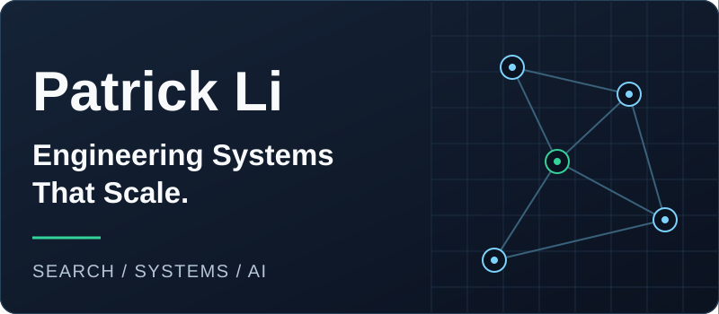
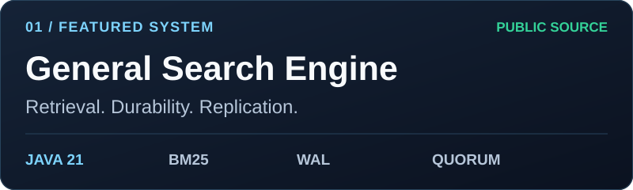
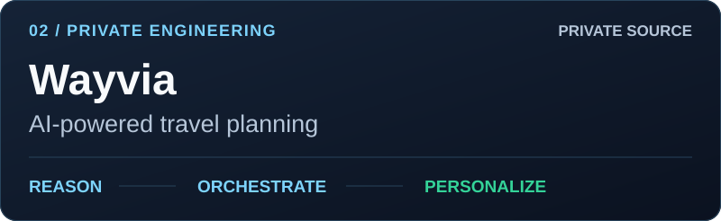

**Research Engineer · Distributed Systems · Information Retrieval · AI Infrastructure**

[GitHub](https://github.com/patricklfdm) · [LinkedIn](https://www.linkedin.com/in/penggao-li) · [Email](mailto:penggaol@alumni.cmu.edu)

## About

I'm Penggao (Patrick) Li, a Research Engineer at **Pacific Sports Promotion Association**, working on distributed systems and information retrieval. Previously, I built AI-powered travel planning workflows as a Software Development Engineer at **Wayvia LLC**. My work connects reliable search infrastructure with the products built on top of it.

M.S. Electrical and Computer Engineering — **Carnegie Mellon University**, 2025  
B.S. Computer Engineering — **University of California, Irvine**, 2023

## Featured system · General Search Engine

**Search Infrastructure for Sports Analytics** — an open-source, general-purpose Java 21 search engine supporting concurrent ingestion and retrieval.

- **Retrieval:** typed filtering, positional full-text search, BM25 ranking, and immutable snapshots.
- **Durability:** WAL, group commit, and atomic checkpoints, with deterministic recovery, consistent backups, verified restores, and offline storage-format migration.
- **Replication:** quorum replication, automatic leader election, durable epochs, fencing, and safe membership transitions, preserving committed history through failover and recovery.
- **Replica reads:** strong leader, stale follower, and token-based minimum-progress policies, with snapshot-consistent views, deadline-aware waiting, admission control, and backpressure.
- **Evaluation:** 2.50 ms P50 / 5.26 ms P99 query latency on 4K documents in a three-node GCP deployment; 61 workload and fault-injection scenario executions.
- **Delivery:** tiered GitHub Actions CI/CD, change-aware test selection, compatibility gates, and reproducible Maven releases.

[Explore public source](https://github.com/patricklfdm/GeneralSearchEngine) · [Architecture & engineering notes](showcase/general-search-engine.md)

## Private engineering showcase

**AI Engineering · Workflow Orchestration · Full-Stack Development**

Wayvia generates personalized travel itineraries through multi-stage LLM planning, semantic preference matching, and asynchronous workflows. Engineering areas span PostgreSQL and Redis state management, Next.js and NestJS applications, WebSocket progress updates, and AWS deployment with Docker, CI/CD, and observability.

[Read the public overview](showcase/wayvia.md) · Source remains private.

## Research directions

**Planned investigations** connecting consistency, latency, and retrieval quality:

- **Consistency-Constrained Adaptive Replica Selection** — investigating how to select replicas under explicit consistency and latency constraints.
- **Adaptive Distributed Top-K Retrieval** — exploring adaptive query processing and distributed retrieval strategies.

[Research questions & scope](showcase/research-directions.md)

## Technology stack

- **Languages:** Java · Python · TypeScript · JavaScript · SQL · C/C++
- **Distributed systems & data:** PostgreSQL · Redis · Kafka · MySQL
- **Backend & web:** Next.js · React · NestJS · Spring Boot · Django
- **Cloud & DevOps:** GCP · AWS · Docker · GitHub Actions · Maven · Prometheus · Grafana

## GitHub activity

Explore my public work and contribution timeline on [GitHub](https://github.com/patricklfdm). Activity is shown through GitHub's native profile features.

## Contact

Interested in search infrastructure, distributed systems, or AI engineering?  
[LinkedIn](https://www.linkedin.com/in/penggao-li) · [penggaol@alumni.cmu.edu](mailto:penggaol@alumni.cmu.edu)
