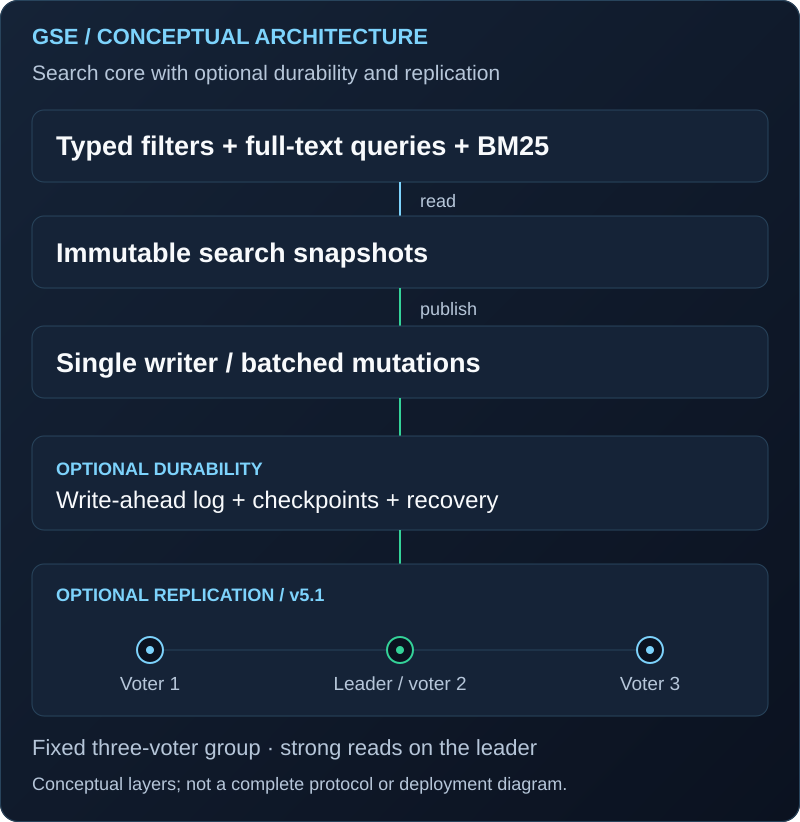

# 🔍 General Search Engine

[Back to profile](../README.md) · [Public repository](https://github.com/patricklfdm/GeneralSearchEngine)

**Search Infrastructure for Sports Analytics**

An open-source, general-purpose Java 21 search engine integrating typed filtering, positional full-text search, BM25 ranking, and immutable snapshots to support concurrent ingestion and retrieval.

## Storage and recovery

Crash-consistent storage combines WAL, group commit, and atomic checkpoints. Engineering work includes deterministic recovery, checkpoint-consistent backups, verified restores, and source-preserving offline storage-format migration.

## Replication and replica reads

Quorum replication combines automatic leader election, durable epochs, fencing, and safe membership transitions to preserve committed history across failover, replica catch-up, and snapshot recovery.

Consistency-aware replica reads provide strong leader, stale follower, and token-based minimum-progress policies. Snapshot-consistent views and deadline-aware asynchronous waiting work alongside admission control and backpressure to bound in-flight work.

## Evaluation

Measured **2.50 ms P50 / 5.26 ms P99 query latency** on **4K documents** in **three-node GCP deployments**, with automatic failover and recovery validated across **61 workload and fault-injection scenario executions**.

## Delivery and reproducibility

Tiered GitHub Actions CI/CD uses change-aware test selection, parallel execution, compatibility gates, and full-suite fallback, supporting reproducible Maven releases and replayable experimental evidence.

## Architecture

Conceptual v5.1 architecture: immutable search snapshots, a single writer, optional durability, and a fixed three-voter replication group.
